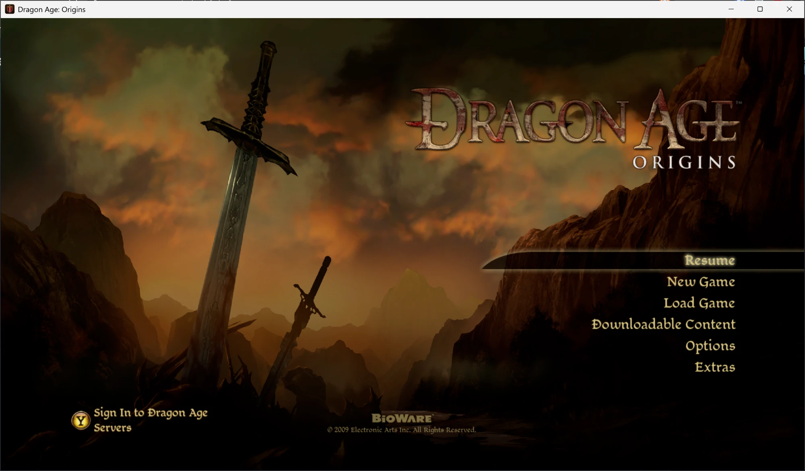
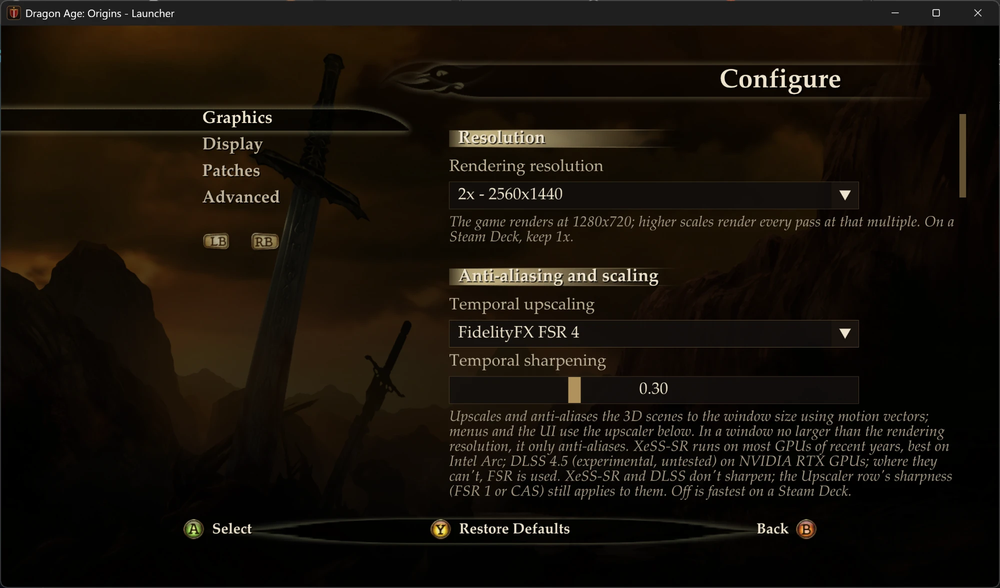
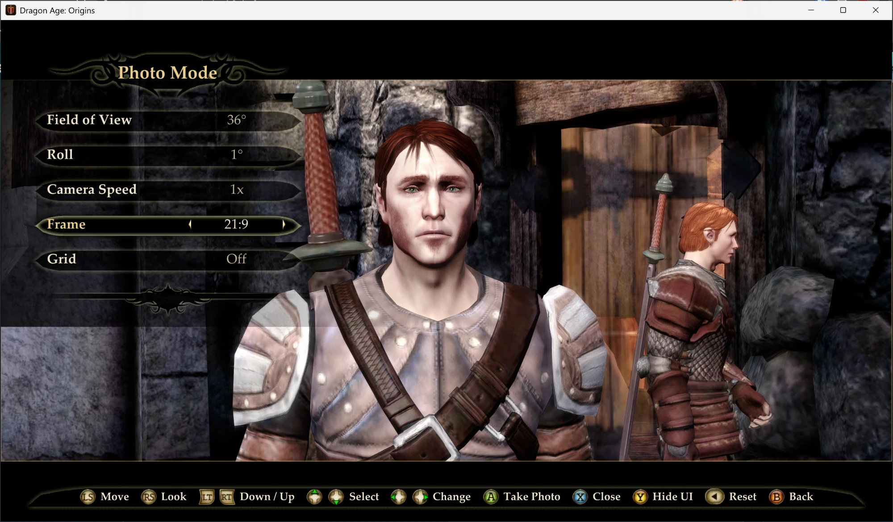

# Dragon Age: Origins — Recompiled

A static recompilation of the Xbox 360 version of *Dragon Age: Origins* into a native
x86-64 Windows program, with a Direct3D 12 renderer based on Xenia's. It adds:

- rendering at up to 4K (and higher), with FSR 1 / CAS scaling of the whole image
- temporal upscaling and anti-aliasing with AMD FSR 4 (RDNA 4), FSR 3.1, Intel XeSS-SR
  or NVIDIA DLSS 4.5 (RTX GPUs, experimental), using motion vectors generated for the
  game's 3D scenes, which also drive optional motion blur (of the camera, characters and
  objects), and optional FSR 3.1
  frame generation (a frame between each two, for a display at twice the frame rate;
  only real frames are shown on one that can't keep up)
- neural rendering on AMD RDNA 4 (experimental): lmxxf's open-source port of DLSS 5's
  neural rendering, built in, with the network's weights from your download of
  lmxxf's package (they're NVIDIA's, and not included)
- depth of field in conversations (and, it seems, cutscenes), from the scene's depth,
  with temporal upscaling: the people nearest the camera sharp, the scene behind them
  blurred, as a film camera's lens does
- HDR output: on an HDR display the 3D scenes are rendered in HDR (the game's
  tonemapping redone without compressing its highlights), upscaled in HDR;
  HDR quality High keeps it 16-bit scRGB all the way to the display
- 60 fps (the original is locked to 30), or up to 240 or unlimited (experimental)
- low latency with AMD Radeon Anti-Lag 2 (AMD GPUs) or NVIDIA Reflex (NVIDIA GPUs,
  experimental)
- field of view settings: gameplay's, and conversations' (and, it seems, cutscenes')
  separately
- SDL3 input, including DualSense and other controllers
- a launcher for settings, mods (file overrides, with a converter for PC mods) and
  code patches
- a Graphics tab in the game's own Options menu (title and pause menus)
- a photo mode (the START menu's Photo Mode row, or L3+R3): a free camera with the
  world paused, field of view, roll, frames from 32:9 to 9:16 and composition grids,
  saving PNGs to Pictures\DAORecomp
- a cheats menu (the START menu's Cheats row, *Options → Graphics → Open cheats* in a
  game, or F7): the developers' own debug scripts, still in the game, for immortality,
  skill checks, gold, experience and more
- an on-screen keyboard for naming characters, usable with a gamepad
- the downloadable content (Awakening and the rest), installed from your own packages
- the game's text in English, Italian or Spanish (the languages on the disc; the voices
  are English in each), chosen in the launcher

**This repository contains no game code or data.** You need your own copy of the
game: an ISO image of the Xbox 360 disc. The installer extracts it, translates the
game's code to C++ on your computer, and builds the program.

## Screenshots

<p>
  
  
</p>
<p>
  
</p>

## Installing

You need:

- An x86-64 PC running Windows 10/11 or Linux, with a Direct3D 12 capable GPU and a
  processor with AVX (most from 2011 or later). The game is built for your processor:
  with AVX2 (Intel from 2013, AMD from 2015) it uses those newer instructions. A copy
  built that way and moved to a PC without them says so when it starts; run the
  installer on that PC to build it for its processor.
- The disc image of *Dragon Age: Origins* for Xbox 360 (title ID 454108C0): the
  English, Italian and Spanish edition (media ID 186A1115), which is also disc 1 of that
  edition's *Ultimate Edition*. The installer checks that it is the supported release
  (the French and German editions are other discs, not supported). The game's language
  is chosen in the launcher (*Configure → Advanced → Game language*, or `language` in
  the `[game]` section of `userdata/config.toml`).
- About 25 GB of disk space: 8 GB for the game, the rest for the tools and the build.
  The first build takes 30–60 minutes, depending on the CPU.

### Windows

Download **DAORecomp.exe** from the releases and run it: it opens on its Install page,
drawn like the launcher (with the title screen from your disc once you pick it). Pick the
ISO and an install folder, accept the build tools license, and press **Install**.
Nothing else needs to be installed first: it downloads what it needs (including a
portable git if you have none). It builds the game into the install folder as a new
`DAORecomp.exe`, which then opens as the launcher: **Play** starts the game. It can also
add Start menu and desktop shortcuts, and add the game to Steam.

The disc image and the folder can be given to it (or the ISO dropped on it):

```
DAORecomp.exe --iso "D:\Games\Dragon Age Origins.iso" --dest "D:\Games\DAORecomp"
```

The tools and the build go into `%LOCALAPPDATA%\DAORecomp-build` (set `DAO_WORK_DIR` to
use another folder). Keep it and a newer installer only rebuilds what changed; delete it
to get the space back.

Windows may warn about `DAORecomp.exe` because it isn't code-signed (*More info* →
*Run anyway*).

#### Title updates and downloadable content

*Awakening*, *Leliana's Song*, *The Darkspawn Chronicles*, *The Golems of Amgarrak* and
*Witch Hunt* need the game's Title Update 6 or 7 (the other DLC work without it; 7, the
last, adds fixes to 6's in its data files). To use them,
copy the title update's package and the DLC packages from a console (or your backup of
them) and:

- give the installer the title update's package: *Title Update 6 or 7 (optional)* in the
  window, or `--title-update <package>`. It is checked (it must be the one for the
  English, Italian and Spanish disc, media ID 186A1115), extracted to `title_update/` in the install folder,
  and the game's code is translated a second time from the updated executable (about as
  long again). The program then holds both versions and runs the updated one while
  `title_update/` is there.
- drop the DLC packages, or the folder holding them, on the launcher window. They are
  extracted to `userdata/content/454108C0/00000002/`, where the game finds them. A title
  update dropped there is installed too (7 replaces 6); if the program was built without
  one, it takes effect after running the installer again on the same folder.

Only packages in the read-only format Xbox Live delivers them in (LIVE/PIRS) are read;
the packages themselves are left as they are. At start, `title_update/default.xexp` is
checked to be Title Update 6's or 7's; anything else is passed over for the disc's version.
The launcher's *Downloadable Content* shows which DLC and title update are installed
(and whether the game can use them), and packages can be dropped there too.

### Linux (or from the source on Windows)

Install Python 3.10+ with Tkinter, git and a C++ standard library (Debian/Ubuntu:
`sudo apt install build-essential python3-tk git`; Fedora:
`sudo dnf install gcc-c++ python3-tkinter git`; Arch: `sudo pacman -S base-devel tk git`). Then:

```
git clone <this repository> DAORecomp
cd DAORecomp
python3 install.py
```

or `python3 install.py --iso "/path/to/Dragon Age Origins.iso" --dest ~/Games/DAORecomp`.
Here the tools and the build go into `tools/` and `build/` inside the checkout, and
after a `git pull` the installer rebuilds only what changed.

Running the installer again resumes an interrupted install.

### Updating

The launcher looks for a newer release when it opens and, if there is one, shows an
**Update** item with the release notes. It downloads the new release's `DAORecomp.exe`
into `update/` in the install folder, checks it against the SHA-256 GitHub lists for it,
and runs it on the same folder; it rebuilds only what changed (the disc image isn't
needed again) and keeps your saves, settings and mods. The checksum catches a damaged
or altered download; like the release itself, it comes from this GitHub repository.

There are two update channels, chosen in *Configure → Advanced* (or with
`update_channel = "release"` or `"dev"` in `[launcher]`):

- **Release** (the default): releases only (`vX.Y.Z`; while the version is 0.x they're
  marked pre-release on GitHub, and offered all the same).
- **Dev**: dev releases too (`vX.Y.Z-dev.N`): test builds published between releases, for
  trying what's next early. They can have bugs. An install made from a dev release starts
  on this channel.

The check asks `api.github.com/repos/96dot/Dragon-Age-Origins-Recomp/releases` for the
list of releases; the request carries only the program's version. Launchers up to
v0.10.0-dev.5 don't see releases since the repository was renamed (from `DAORecomp`):
update those by hand once. Turn the check off in *Configure → Advanced* or with
`check_updates = false` in the `[launcher]` section of `userdata/config.toml`.
Builds from source (`dev`, or a changed checkout of a release or dev release) don't check.
With the launcher hidden there is no check: open it now and then (hold Shift).

To update by hand, run a newer release's `DAORecomp.exe` and choose the same install
folder (or give it `--dest`). Under Wine or Proton the launcher only links to the
release page: update the checkout (`git pull`, or check out the new tag) and run
`python3 install.py --dest <install folder>`.

### What it downloads

Everything is pinned to exact versions and checked (`installer/deps.py`):

- Source code: Xenia's third-party libraries (and rapidjson, for the update check),
  XenonRecomp, SDL 3, the AMD FidelityFX SDK (headers and the signed FSR and frame generation
  DLLs), the Intel XeSS SDK (headers, `libxess.dll` and its license notices; the
  release archive, of which only those are kept), and NVIDIA's Streamline SDK 2.14.1
  (of its release archive, only its headers, its DLLs and NVIDIA's DLSS 310.9 and
  Reflex DLLs with their licenses are kept; DLSS Frame Generation's aren't installed yet).
- LLVM/Clang 22 (or your system's LLVM 18+ if it has `clang-cl`, `lld-link`, `llvm-lib`
  and `llvm-rc`), CMake and Ninja, and on Windows without git, MinGit.
- The Microsoft C/C++ runtime headers/libraries and the Windows SDK, fetched by
  [xwin](https://github.com/Jake-Shadle/xwin). These are under
  [Microsoft's license](https://go.microsoft.com/fwlink/?LinkId=2086102), which you
  are asked to accept. No Visual Studio installation is needed.

The install folder gets the game files (`game/`), the program, `userdata/` (settings,
saves, save backups, installed DLC, logs, the shader cache, and the Options menu it
generates), `mods/`, and with the title update, `title_update/`. On a PC with an AMD
RDNA 4 GPU (Radeon RX 9000 series) and AMD's driver, it also gets `neural/`: neural
rendering's GPU kernels, compiled for that GPU during the install by the driver's own
compiler (`amd_comgr_3.dll`; a minute or two the first time, and again after a driver
update), and the shaders it compiles, and `DLSS5-AMD/`: its settings and logs. An install
on a PC without such a GPU removes an earlier install's kernels and shaders (your own
files there stay; if AMD's driver can't say which GPU it is, they stay too).

When you save over a save, the version it replaces is kept in
`userdata/save_backups/`: one per save, the one before its latest overwrite (a save
the game crashed while writing doesn't replace it). When the old save can't be kept (the
drive is nearly full, or it can't be copied) or the new one's folder can't be made, the
save isn't overwritten at all: a message over the game says it wasn't saved, and the old
one stays. Closing the window while the game is saving waits (10 seconds at most) for the
save to be finished. To get one back, open the launcher's *Save Backups*: it lists them by
character, with when each backup and the save in its place were made. *Restore* puts
the backup back (after asking, and not while the game is running), and the save it
replaces becomes the backup, so restoring again switches back. (A `<save>.new` folder
in `save_backups/` is a backup that couldn't be put in place; the log says why. A
`<save>~current` one is the save a restore set aside, put back when the list is next
read with the game closed.)

## Playing

- **Windows:** run `DAORecomp.exe` in the install folder. The launcher opens first
  (hold Shift while starting to show it when it is turned off). It is drawn with the
  title screen and menu art from your copy of the game (`guiexport.erf`, read at
  startup; none of it is shipped), falling back to plain shapes without it, and uses
  Windows' serif fonts (Palatino Linotype, Georgia or Times New Roman). It works with
  a mouse, the keyboard or any gamepads SDL knows (Xbox, DualSense, DualShock...): the
  d-pad or left stick moves between items, A/Cross selects, B/Circle goes back, LB/RB
  (L1/R1) switch Configure's tabs, the right stick scrolls, Start plays. The button
  hints show the buttons of the gamepad used last. `--launcher` shows it anyway,
  `--mods` opens it on its Mods page, and `--play` skips it.

  *Configure → Advanced → Add to Steam* adds the game to Steam as a non-Steam game, for
  each Steam account on the PC, with library artwork drawn from the title screen. Steam
  starts it with `--play`, straight into the game (for Big Picture). Steam has to be
  closed for that: the launcher asks first, and starts it again after. If Steam gets
  stuck while closing, the launcher offers to end it after 15 seconds. If Windows still
  can't let go of it after that, Steam won't start again until the PC is restarted. The old
  `shortcuts.vdf` is kept beside it as `shortcuts.vdf.daorecomp-backup`.

  In the game, F11 switches between fullscreen and a window until the game is closed
  (the Graphics tab's *Fullscreen* saves it).
- **Linux:** the program is a Windows executable; run it with Wine or Proton.
  - Steam: *Add a Non-Steam Game* → `DAORecomp.exe`, then in its properties force a
    Proton version (Proton includes vkd3d-proton for Direct3D 12).
  - Wine: install vkd3d-proton into the prefix (`winetricks vkd3d`), then run `./run.sh`.

  Linux support is untested so far. The program needs Wine's support for placeholder
  memory views (`VirtualAlloc2`/`MapViewOfFile3`) and Direct3D 12 through vkd3d-proton.
  FSR 4 needs AMD's Windows driver and is unlikely to work under Proton; choose FSR 3.1
  in the launcher (XeSS-SR and DLSS are untested there).

Most graphics settings can also be changed in the game: *Options → Graphics*. Most
apply at once; when you leave the menu, the game lists the ones that take effect
the next time it starts. Turning off dynamic shadows and post-processing there (or in the
launcher) makes the game faster on low-power devices such as the Steam Deck. Motion
blur is off by default; Low and High cost GPU time while the scene moves. Depth of field
in conversations is on by default; it costs GPU time in conversations only (about
0.85 ms a frame at 4K on an RX 9070 XT).

**Low latency** (*Configure → Display → Frame rate* in the launcher, or *Options →
Graphics*, where it applies at once) turns on AMD Radeon Anti-Lag 2 on AMD GPUs with a
current driver, or NVIDIA Reflex on NVIDIA GPUs: each frame starts as late as it can
still be on time, so the controller is read closer to when the frame is shown. It does
the most when the GPU is the limit (an unlimited frame rate, or one the GPU can't quite
reach), where frames would otherwise wait in a queue; at a frame rate the GPU reaches
easily there's little to gain. Anti-Lag 2 cost no frames in tests on an RX 9070 XT. It's off
while *FSR Frame Generation* is on: Anti-Lag 2 works with FSR 3's own way of showing generated
frames, not this game's, and cost frames with it (Reflex is kept off likewise). *On +
Boost* is Reflex's boost (more GPU clock for lower latency, at some power); on AMD GPUs
it's the same as *On*. On other GPUs it does nothing. `userdata/xenia.log` says whether
it's available and on.

Reflex and DLSS are experimental: they're built on NVIDIA's Streamline (its DLLs and
DLSS 4.5's, `nvngx_dlss.dll` version 310.9, which the installer downloads, next to
`DAORecomp.exe`) without an NVIDIA GPU to test on. Streamline only starts on an NVIDIA
GPU, and only when *Low latency* is on or DLSS is the temporal upscaler as the game
starts; turning low latency on from *Off* there otherwise takes effect at the next start,
as does choosing DLSS (the game's Graphics tab says so; if Streamline can't start at all,
`userdata/xenia.log` says why). DLSS uses the presets NVIDIA recommends for each mode
(K, and the second generation models M and L for Performance and Ultra Performance);
where it can't run (no RTX GPU, an upscaling ratio beyond what DLSS's modes cover, about
3x), FSR upscales instead. The game only loads Streamline's `sl.interposer.dll` if it's
exactly the installer's, and downloads nothing while it runs; NVIDIA's driver may use a
newer DLSS it already has.

**Neural rendering (experimental, AMD RDNA 4 only):** the 3D scenes go through the
neural rendering network of NVIDIA's DLSS 5 before temporal upscaling, run on AMD's
GPUs by [lmxxf's port](https://github.com/lmxxf/dlss5-on-amd-9070xt-porting) (MIT),
built from its source into `LmxxfNrRuntime.dll`. The network's weights are NVIDIA's and
don't come with the game: download lmxxf's release package (linked from its README), then
in the launcher's *Configure → Graphics* turn on *Neural rendering* and choose the
package's folder with *Browse* (its folder with `block0-ffn.f16` is searched for, four
levels down at most; if it isn't found, choose that folder itself). The option
is there when the install has its kernels (installed on a PC with an RX 9000 series GPU:
install again after changing to one), and needs temporal upscaling on. It's expensive: lmxxf
measures about 7 ms of GPU time a frame for its 900-line network and 9.5 ms for 1080
lines on an RX 9070 XT. It works with HDR output too (the network gets the scene in linear
light, as DLSS 5 takes HDR, and the highlights above paper white keep their brightness),
takes effect when the game starts, and loading the network holds the first frames (the logos)
for a second or two.
*Neural rendering strength* (also in *Options → Graphics*, where it applies at once)
sets how much of the network's change of detail and colour is kept, from none (0, which skips
the network: no GPU time for it, though it stays loaded; so does anything under 0.05) to all (1).
The options lmxxf's packages have are there too (in both; they take effect when the game
starts): *quality* is the network's size, which the 3D scenes are fitted to (Auto picks the
smallest they fit: 720 lines at `resolution_scale = 1` and 1080 above; 900 and 720 are
faster), *passes* runs the
network two or three times a frame for a stronger look (each pass costs as much as the first;
the third is predicted from the first two), *protect skin* keeps skin as the first pass made
it, and *style* is one of NVIDIA's three (0 is NVIDIA's default, 1 lmxxf's). The installer
puts lmxxf's settings template for this runtime in `DLSS5-AMD/default-config.txt`; these
settings override it, and the runtime keeps its own logs in `DLSS5-AMD/logs`. Its problems
are logged to `userdata/xenia.log`, and then it's off for the session. In the game, F6
switches it off and back on at once, to compare, when it was on as the game started (the
keyboard only, while the game's window is in front).
*Ease off neural rendering to hold the frame rate* (on by default, in the launcher and in
*Options → Graphics*, where it applies at once) fades the network out while the GPU can't hold
the frame rate with it, and back in when the GPU has room for it again; `userdata/xenia.log`
says when ("Frame rate guard"). It measures the GPU's time a frame, so it eases off only when
the GPU is what holds the frames back, and does nothing with the frame rate unlimited.

[OptiScaler](https://github.com/optiscaler/OptiScaler) can take over the temporal upscaling
(as can unofficial forks of it, such as AMD-NR). It isn't included: copy its files next to
`DAORecomp.exe` without replacing the `amd_fidelityfx_*.dll` files already there, rename
`OptiScaler.dll` to `dxgi.dll`, and keep *Temporal upscaling* on (not Off), since that's what
it replaces. A `dxgi.dll` there runs as part of the game, launcher included, every time it
starts, so only use a build you trust. AMD-NR's Neural Rendering is expensive: about 13 ms a
frame on an RX 9070 XT at `resolution_scale = 2` (1440p) with 4K output, too much for 60 fps;
`AmdLmxxfTierCap=720` under `[DlssNr]` in `OptiScaler.ini` halves that. If the upscaling
keeps failing through it, the game falls back to regular scaling for the session, and
`userdata/xenia.log` names the DLL; OptiScaler's own log says why (it may contain your user
name: check before sharing it). To remove it, delete `dxgi.dll` and the files and folders it
came with.

Mods go in `mods/` (see `mods/README.txt`); the easiest way to add one is to drop its
archive, folder or files on the launcher window (archives are opened with Windows'
`tar.exe`, in Windows 10 1803 and later). PC mods with models, textures or archives
are marked as such and not loaded until converted (select one and press *Convert*); the
launcher also warns of what it finds in a mod that may not work on this version. The
first time the Mods page opens it explains this (`mods_warning_seen` in the
`[launcher]` section of `userdata/config.toml` records that it was read). In the game,
*Options → Graphics → Manage mods* closes it and opens the launcher's Mods page.

Photo mode starts from the START menu's *Photo Mode* row (below *Achievements*, which
stays greyed: there are no achievements here) or by clicking both sticks (L3+R3) while
exploring or in combat; the world
pauses and the camera flies free. The left stick moves it, the right stick turns it, the
triggers lower and raise it (LB slower, RB faster); the d-pad zooms and rolls, A takes a
photo (saved in `Pictures\DAORecomp`, cut to the chosen frame, without the overlay, and in
SDR when the game is in HDR), X opens the settings (field of view, roll, camera speed,
frame, grid), Y hides the overlay, BACK resets the camera, and B or START leaves. On its
own, a stick click reaches the game 80 ms late (the other may still come).

The cheats menu opens from the START menu's *Cheats* row or *Options → Graphics → Open
cheats* (paused from exploration or combat), or with F7 (the keyboard only, while the
game's window is in front), in exploration or combat;
the world pauses under it. Each cheat runs one of the scripts BioWare's developers left in
the game (the PC version's console ran them with `runscript`), through the game's own
script engine:

| Cheat | Script | What it does |
|---|---|---|
| Immortal Party | `pc_immortal`, as each party member | the party still takes damage but can't die (A again makes those it made immortal mortal) |
| Win Every Skill Check | `zz_override_skills` | persuasion, intimidation and the other skill checks in conversations always succeed |
| Kill Nearby Enemies | `killallhostiles` | kills up to 30 enemies the party leader can see, even those the story keeps alive (some fights may not end as they should) |
| Add Gold | `zz_money` | 1, 10, 100 or 1,000 gold (left and right) |
| Add Experience | `addxp` | 1,000, 5,000, 20,000 or 100,000 experience for the party |
| Strengthen Party | `zz_supercrit`, for each party member | health and mana 1,000, strength and dexterity 50; permanent |

They change the save like anything else in the game: back it up first (the launcher's
*Save Backups*) if you may want it as it was. B or START closes the menu.

Shaders are compiled the first time something is drawn, and that draw is skipped
until then, so new places can show objects popping in for a moment. Compiled shaders
are kept in `userdata/shader_cache/` and compiled again in the background at every
start, so this happens once per place.

## Developing

[CONTRIBUTING.md](CONTRIBUTING.md) is the map: how the code is laid out, how changes
are tested, and the traps found so far. The build details are below.

- `CMakeLists.txt` builds the runtime (`DAORecomp/`), Xenia's GPU/UI code
  (`xenia/src`, vendored and patched) and the recompiled game code (`ppc/`, generated).
- `cmake/clang-cl-xwin.cmake` is the toolchain the installer uses on both systems.
- The build expects the installer's downloads under `tools/` (run `python install.py`
  once, or its `--prepare-only` step): among them the FidelityFX SDK and
  `tools/XeSS-SDK` (`installer/toolchain.py`'s `ensure_xess`) and `tools/Streamline-SDK`
  (`ensure_streamline`), whose DLLs are copied next to the exe.
- `thirdparty/lmxxf-nr` is the part of lmxxf's neural rendering source the game builds
  (`LmxxfNrRuntime.dll`, from `DAORecomp/neural/lmxxf_runtime.cpp`) and the installer
  compiles (`installer/neural.py`, its HIP kernels by `thirdparty/lmxxf-nr/hip/build-modules.ps1`'s recipe):
  copied from a checkout by `scripts/vendor_lmxxf.py`, which records the commit in
  `SOURCE`. Never the network's weights.
- `scripts/build_setup_exe.py` builds `dist/DAORecomp.exe`, what players download: the
  launcher alone (`-DDAO_LAUNCHER_ONLY=ON`) with the installer appended to it, which it
  unpacks to run. The installer is `scripts/build_installer_engine.py`'s folder:
  python.org's embeddable Python (signed by the Python Software Foundation; the
  PyInstaller exe it replaced was deleted by antivirus as a false positive) and
  `installer.pyz`, the files tracked by git with truststore. The *Windows installer*
  workflow builds the folder and the exe, and publishes `DAORecomp.exe` also as
  `DAORecomp-Installer.exe`, the name launchers up to v0.5.1 update with.
- `config/DAO.toml` and `config/DAO_switch_tables.toml` tell XenonRecomp where the game's
  functions and jump tables are; `scripts/patch_recompiler.py` adds the PowerPC
  instructions XenonRecomp lacked.
- Title Update 6 is a second build of the game in the same program:
  `config/DAO_tu6.toml` and `config/DAO_tu6_switch_tables.toml` describe it,
  `scripts/recomp.cmd tu6` translates it into `ppc_tu6/` (built when that folder exists),
  and `scripts/prefix_symbols.py` gives its functions names of their own (`tu6_sub_...`).
  Title Update 7 runs on the same code: its code differs from 6's only in a version number
  (set by `DAORecomp/kernel/title_update_version.cpp`) and a global that moved, so
  either's patch can be translated; the rest of 7 is data files.
  The runtime picks the build at start (`DAORecomp/kernel/game_build.h`); code hooks are
  given both builds' functions with `GAME_HOOK` (one build's with `GAME_HOOK_ONE`), and addresses both builds' with
  `GameAddress`. `scripts/match_build.py` finds a disc function's counterpart in the
  updated executable, and the analysis scripts take `DAO_VARIANT=tu6` (or `tu7`).
  `scripts/check_tu7.py` checks that 7 still runs on 6's build after a change.
- `scripts/stfs.py` lists and extracts Xbox 360 packages (`info`/`extract`); the
  installer uses it. `DAORecomp/content/stfs.cpp` is the same reader for the launcher
  (which has no Python): keep the two in step. `scripts/test_stfs.py` tests both on
  packages it makes (pass `build/DAORecomp/DAORecomp.exe` for the C++ one; CI runs the
  Python one), and `scripts/check_constants.py` checks that the IDs, the title
  updates' hashes and the other values `installer/deps.py` shares with the program
  match every copy of them in it.
- `scripts/` also has the development tools used to analyse the game and build the
  shaders (`build_xenia_shaders.py` needs FXC from the Windows SDK and xenia-canary's
  FidelityFX-CAS/FSR submodules; the compiled shaders are committed).
- `scripts/make_icon.py` draws the program's icon (`DAORecomp/res/daorecomp.ico`,
  original art); it needs Pillow, and the .ico is committed, so it's only run to
  change the icon.
- The in-game Graphics tab and the START menu's Photo Mode and Cheats rows are ActionScript 2
  (`DAORecomp/ui/graphics_tab.as`, `DAORecomp/ui/pause_menu.as`), which
  `scripts/as2c.py` compiles to `DAORecomp/ui/graphics_tab_as.h` and
  `DAORecomp/ui/pause_menu_as.h`; run
  `python scripts/as2c.py DAORecomp/ui/graphics_tab.as DAORecomp/ui/graphics_tab_as.h kGraphicsTabScript`
  (or `... pause_menu.as ... pause_menu_as.h kPauseMenuScript`) after changing one (with
  `--check` at the end it only checks the header, as CI does). At start the runtime
  adds the scripts to the player's own `optionsmenu.gfx` and `mainmenu.gfx`
  (`DAORecomp/ui/menu_movies.cpp`) and serves the results from `userdata/generated/`.
- `scripts/check_include_case.py` finds `#include`s whose case differs from the file on
  disk, which only breaks builds on Linux.
- `DAO_CONSOLE=1` shows the log (`userdata/dao.log`) as it's written, in the console
  the game was started from or a new one. The game has no console of its own, but
  output redirected to a file or a pipe gets the log without this. Closing a console it
  opened ends the game.
- Diagnostics, set as environment variables (results in `userdata/xenia.log`):
  - `DAO_GPU_TIMING=1`: GPU time per section of a frame and pipeline statistics per
    kind of draw and per shader pair, every 300 frames (`GT` lines; slows rendering).
  - `DAO_DRED=1`: when the GPU device is lost, the operations it was running and the
    memory it faulted on (Direct3D 12 DRED).
  - `DAO_LAUNCHER_SCREENSHOTS=<folder>`: saves each launcher view (the title screen,
    the four Configure tabs, Mods: its list, even before the first-open notice was
    read, Save Backups, Downloadable Content) as `launcher_0.bmp` to `launcher_7.bmp`, and
    the Update page as `launcher_8.bmp` when the update check finds a release, then quits.
  - `DAO_LAUNCHER_DROP=<path>|<path>...`: with `DAO_LAUNCHER_SCREENSHOTS`, adds those
    as if dropped on the window (tests adding mods and installing packages).
  - `DAO_LAUNCHER_PAD=<steps>`: with `DAO_LAUNCHER_SCREENSHOTS`, a virtual DualSense
    follows these steps (separated by spaces), 12 frames each, instead of the views'
    screenshots, then quits: a button pressed (`a b x y lb rb start up down left right`)
    or the left stick pushed (`ls-up`, `ls-down`, `ls-left`, `ls-right`) for 3 frames,
    the right stick held for 11 (`rs-up`, `rs-down`), `wait`, or `shot` (saved as
    `launcher_pad_0.bmp` and on); an unknown step is logged and passed over. It is the
    only gamepad then, and presses even with the window in the background.
  - `DAO_BUILD=disc`: runs the disc's build even when a title update is installed.
  - `DAO_EXTRACT_PACKAGE=<package>|<new folder>`: extracts an Xbox 360 package as the
    launcher does, prints the outcome and quits (used by `scripts/test_stfs.py`).
  - `DAO_CONVERT_MOD=<mod folder>`: converts that PC mod as the launcher's Convert does,
    logs the outcome to `userdata/dao.log` and quits (tests the converter).
  - `DAO_TEST_KEYBOARD=<seconds>`: shows the on-screen keyboard that long after the
    game starts and logs what was entered (tests it without creating a character).
  - `DAO_PHOTO_DIR=<folder>`: photo mode saves its photos there instead of
    `Pictures\DAORecomp` (`scripts/test/inputs/photo_mode.txt`).
  - `DAO_STREAMLINE_ANY_GPU=1`: with *Low latency* on, starts NVIDIA's Streamline on any
    GPU, not only NVIDIA's (Reflex's sleep does nothing there, but the rest runs: its
    proxies, the swap chain through them, its markers; Anti-Lag 2 is then not used), to
    test it without one.

Never commit game files or anything generated from them (`game/`, `ppc/`, `ppc_tu6/`,
`analysis/`, `title_update/`, `dlc/`, built executables); `.gitignore` excludes them.

## License

MIT (see `LICENSE`), except `xenia/`, which is Xenia's code under its BSD license
(`xenia/LICENSE`). The downloaded dependencies keep their own licenses; the FidelityFX
license is copied next to its DLLs, and Intel's XeSS license and third-party notices
next to `libxess.dll` (`intel_xess_license.txt`, `intel_xess_third_party_programs.txt`).
`thirdparty/lmxxf-nr` is lmxxf's code under the MIT license, with AMD's HIP API headers
under theirs (MIT); both licenses are installed next to `LmxxfNrRuntime.dll`
(`lmxxf_nr_license.txt`, `lmxxf_nr_hip_api_license.txt`). `thirdparty/antilag2` is
AMD's Anti-Lag 2 SDK header, under its MIT license (installed as
`amd_antilag2_license.txt`). NVIDIA's Streamline (MIT) and its Reflex and DLSS DLLs
(under NVIDIA's license terms) are downloaded by the installer, and their licenses
installed next to them (`nvidia_streamline_license.txt`, `nvidia_reflex_license.txt`,
`nvidia_dlss_license.txt`). The neural rendering network's
weights are NVIDIA's; none of them are in this repository or the releases.
*Dragon Age* is a trademark of Electronic Arts; this project is not affiliated with EA,
BioWare or Microsoft.
